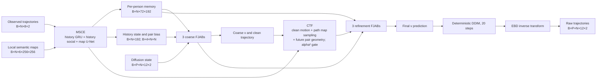

# Endpoint–Bridge Joint Diffusion

Working title: **Endpoint–Bridge Joint Diffusion for Joint Pedestrian
Trajectory Prediction**. EBJD jointly samples all valid pedestrians in each
world while keeping different worlds independent.

## Data flow



Ground-truth future trajectories appear only in training losses and in the
training-only target encoding. They are not an inference input. `P` is the
world dimension; attention is never applied across `P`.

## Named modules and code correspondence

| Paper name | Code location | Input → output | Function |
|---|---|---|---|
| Motion and Scene Context Encoder (MSCE) | `ebjd.encoders.MotionSceneContextEncoder`; registered as `model.encoder` | observations and local maps → per-person memory, social state, pair bias, map features | Encodes history and scene context. |
| Endpoint–Bridge Decomposition (EBD) | `ebjd.representation.EndpointBridgeDecomposition`; registered as `model.representation` | trajectory ↔ 11 bridge variables + 1 endpoint residual | Reversible residual representation; it does not assert probabilistic independence. |
| Geometry-Conditioned Joint Denoiser (GCJD) | `ebjd.denoiser.GeometryConditionedJointDenoiser`; registered as `model.denoiser` | noisy joint latent + context + time → coarse/final velocity predictions | Six-block v-parameterized denoiser. |
| Clean-Trajectory Feedback (CTF) | `_clean_features`, `_sample_map`, `future_pair_geometry` inside GCJD | coarse clean path → motion, path-map and future-pair feedback | Logical feedback path between coarse and refinement blocks; no separate parameter namespace. |
| Factorized Joint Attention Block (FJAB) | `ebjd.denoiser.FactorizedJointAttentionBlock` | `B×P×N×12×192` → same shape | Latent-slot attention, within-world cross-person attention, per-person context cross-attention and FFN. |

Historical Python symbols remain aliases only. The registered attributes
remain `encoder`, `representation` and `denoiser`, so checkpoint keys do not
change or duplicate.

## MSCE

For each observed frame, EBJD concatenates two-dimensional position relative
to the last observation, velocity and acceleration, yielding six values. A
`Linear(6,192)` stem and one-layer GRU produce eight 192-dimensional history
tokens. Two four-head social blocks update the final history state using a
10-dimensional history-only pair geometry mapped to four attention-head
biases.

The map input is six semantic channels plus eight observed-position heatmaps,
not a separate goal diffusion. The original 14-channel U-Net produces 32
full-resolution feature channels and 12 auxiliary future heatmap logits.
Adaptive `8×8` pooling yields 64 map tokens. Each pedestrian therefore owns
`8 + 64 = 72` context tokens of width 192. Full-resolution features are
retained for CTF sampling along the coarse path.

## EBD

Let `b_t` be the constant-velocity reference and `y_t` the target trajectory,
with `T=12`. The endpoint residual is

```math
g = y_T - b_T.
```

For `t=1,…,11`, the bridge residual removes the linear interpolation of `g`:

```math
r_t = y_t - b_t - (t/T)g.
```

With Brownian-bridge covariance
`K_ij = min(i/T,j/T) - (i/T)(j/T)` and Cholesky factor `L`, the 11 bridge
variables are `z_r=L^{-1}r/s_r`; the endpoint variable is `z_g=g/s_g`.
`s_r` and `s_g` are scalar RMS scales fitted only on the training fold, with
0.1 m and 0.5 m floors. Decoding applies the exact inverse and concatenates
the literal endpoint. Brownian-bridge covariance is a whitening device for
the path residual, not a newly constructed diffusion-bridge stochastic
process.

## GCJD, FJAB and CTF

The latent contains 12 two-dimensional slots: 11 whitened bridge variables
and one endpoint residual. A width-192 stem adds slot-time and token-type
embeddings plus the MSCE social state. Each FJAB uses four heads and a
768-dimensional FFN in this order:

1. attention across the 12 latent slots for each `(scene, world, person)`;
2. Social Attention across valid people for each `(scene, world, slot)`;
3. cross-attention to that person's 72-token MSCE memory;
4. feed-forward residual update.

Three coarse FJABs predict bridge and endpoint velocity heads. The resulting
clean estimate produces position/velocity/endpoint features, samples the
full-resolution map features along the coarse trajectory, and computes future
pair geometry. Their refinement contribution is multiplied by `alpha(t)^2`.
Three further FJABs then produce the final velocity heads. Social Attention
never connects different worlds.

## Diffusion and Raw sampling

EBJD uses the cosine VP coefficients

```math
alpha(t)=cos(pi t/2),  sigma(t)=sin(pi t/2),
x_t=alpha x_0+sigma epsilon,
v=alpha epsilon-sigma x_0.
```

The clean estimate is `x_0=alpha x_t-sigma v`. Training samples 100 discrete
nonzero time bins. Formal inference starts from Gaussian noise and applies 20
deterministic DDIM steps (`eta=0`) to 20 worlds. EBD then directly decodes the
final latent; this is the Raw output. There is no native-goal candidate,
anchor residual, Fixed-anchor projection or post-hoc world repair.

## Actual training objective

The default contract uses final bridge/endpoint v-MSE plus a 0.25-weighted
coarse v-MSE. It adds `0.10 × map BCE` and `0.05 ×` alpha-squared-gated
relative motion loss. Beginning at epoch 21, every fourth optimizer update
also uses a differentiable four-world, 20-step rollout objective

```math
L_roll = JADE_soft + 0.5 JFDE_soft + minADE_soft + 0.5 minFDE_soft.
```

Its weight ramps from 0.01 to 0.20 through epoch 40 and is multiplied by 4 to
compensate for its update frequency. AdamW uses learning rates `1e-4` for the
network and `1e-5` for the initialized map U-Net, five warm-up epochs, cosine
decay to 1%, weight decay `1e-4`, and global norm clipping at 5. On rollout
updates, the proposed actual AdamW decrement is projected against the
unclipped soft-marginal ADE/FDE gradients. Geometry, rollout metrics and the
optimizer projection are kept in FP32; compatible CUDA training uses BF16 for
the remaining forward path.
