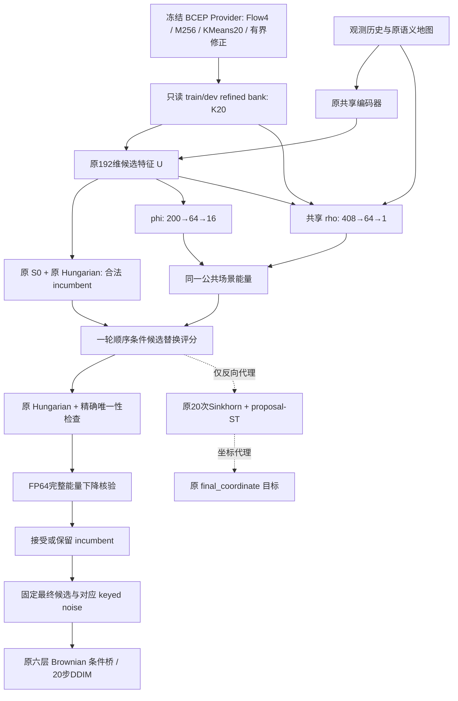

# SSEC 数学定义、数据流与接口

实现位于 [`bcep_scene_energy`](../../../../bcep_scene_energy)。主结构为 **Energy-only（正式 v2 随机初态 + SSEC）**；`energy_csee` 仅增加原 CSEE 的可选候选特征接口。完整历史 v3 的 CSEE/HCRA/GRG-CTF 是独立兼容与成本参照，不是 SSEC 的初始化来源。

## 数据流



所有匹配只在 DDIM 前完成一次；推理调用原 `bcep_joint.inference.generate`，以最终 π 同时 gather 候选和原 keyed noise。不会给重新编号的 world 再生成一份噪声。

## 张量与参数

| 张量/模块 | 形状或接口 | 含义 |
|---|---|---|
| observed / valid | B×N×8×2 / B×N | 原观测，N≤57 |
| proposals | B×20×N×2 | bank 原世界坐标，入口立即 detach |
| U | B×N×20×192 | 原 endpoint + candidate_norm + social_h；可选 CSEE 只在此后增强 |
| q | B×N×6 | 三组观测位移摘要，使用原 goal_scale，observed-only |
| φ 输入/输出 | B×N×20×200 → B×N×20×16 | [U,q,相对候选终点]，Linear–SiLU–Linear |
| 无向边 | E×(scene,i,j)，i<j | 原八邻居图的无向并集，边界距离并列全部保留 |
| ρ 输入/输出 | E×20×20×408 → E×20×20 | [U_i,U_j,R_ij,q_i,q_j]，两个方向共享同一参数 |
| R_ij | E×20×20×12 | 原候选对参考路径/几何特征，先逐真实候选对计算 |
| P_i / S_i | 20×20 / 20×20 | world→candidate 双射/ST 与条件替换评分 |
| assign 输出 | goals[B,20,N,2], π[B,20,N], scores[B,N,20,20] | 与原 objective/inference 接口一致 |

主结构删除旧 `project/compatibility` 反馈参数，保留原共享编码器、S0 及六层桥的对应参数逐字节相同；新增 φ/ρ 以局部 seed3201 初始化，不消耗旧模型构造后的全局 RNG。旧参数相同**不等于**初始最终配对相同：SSEC 具有非零神经势，并非零残差退化成旧反馈。

`scores` 返回的是每人在其访问时刻实际使用的条件评分堆叠，不是对最终 incumbent 再同时求一次的评分。逐次真正参与反传的 score 张量可通过 `return_details=True` 的 `proposal_scores` 取得。

## 公共能量与软扩展

令 zᵢ(a)=φ(Uᵢ(a),qᵢ,gᵢ(a))，边表

\[
C_{ij}(a,b)=\tfrac12[\rho(U_i(a),U_j(b),R_{ij}(a,b),q_i,q_j)
+\rho(U_j(b),U_i(a),R_{ji}(b,a),q_j,q_i)].
\]

只有一份共享 ρ，反向表是相同表的转置。ωᵢⱼ=1/√(dᵢdⱼ)，保持原设计的公共能量：

\[
E_w=\frac1{N-1}\sum_{i<j}\|z_i(\pi_i(w))-z_j(\pi_j(w))\|^2
+\sum_{(i,j)\in\mathcal E}\omega_{ij}C_{ij}(\pi_i(w),\pi_j(w)).
\]

N=1 沿用 identity bypass。对行和为1的 P，必须先对真实候选对代价取期望。令 μᵢʷ=ΣₐPᵢʷᵃzᵢ(a)、mᵢʷ=ΣₐPᵢʷᵃ‖zᵢ(a)‖²，则

\[
E_w=\sum_i m_i^w-\frac{\|\sum_i\mu_i^w\|^2-\sum_i\|\mu_i^w\|^2}{N-1}
+\sum_{ij}\omega_{ij}\sum_{ab}P_{iwa}P_{jwb}C_{ij}(a,b).
\]

实现同时提供快速式与完整候选对参照式，核对硬 P、软 P 以及 φ/ρ/U/行随机 logits 的梯度一致。不能把 mᵢ 换成 ‖μᵢ‖²；后者漏掉候选二阶矩。几何函数中的既有距离/CPA 数值保护保持原样，没有向匹配评分添加破并列 epsilon。

## 条件替换评分

固定其他人，定义

\[
T_i(w,a)=\|z_i(a)\|^2-\frac2{N-1}z_i(a)^\top\sum_{j\ne i}\mu_j^w
+\sum_{j:ij\in\mathcal E}\omega_{ij}\sum_bP_{jwb}C_{ij}(a,b),
\quad S_i(w,a)=-T_i(w,a)+\sum_bP_{iwb}T_i(w,b).
\]

被省略的项不依赖候选 a，因此这个 S **就是** −[E_w(replace i→a)−E_w(current)]。旧 head 或 HCRA MLP 没有被改名成能量；这里有显式可重算的共同 E、共享 C、准确条件差。

全球项的四点差含
\(2\langle z_i(a)-z_i(a'),\sum_{j\ne i}(\mu_j^w-\mu_j^{w'})\rangle/(N-1)\)，局部项也包含跨候选的共享势差。因此它可以具有真实 world–candidate 交互；但学习后的 φ 坍缩、可加 C 或无差异候选仍可能消去交互，本轮没有训练来证明长期不坍缩。

## 协调与 FP64 接受门

按照原有效成员列表访问每人一次，不动态排序，不增加 sweep。每步保留完整 current、proposal、唯一性证书、实际能量前后值及最终接受/拒绝原因。CSV 同时保存该人当前、提案和最终20个候选编号。

评分网络及原 Hungarian 输入为 FP32。核验器只将**同一批已算出的 FP32 z/C/ω**提升到 FP64，对完整硬分配的全局候选对距离及局部表重新求和；不会用另一份网络/参数生成能量。

浮点误差界使用 u=eps64/2、γₘ=mu/(1−mu)。距离项按相减前的 (|xᵢ|+|xⱼ|)² 控制误差，求和按全部展平项数给出保守界，不假定 NumPy 的具体归约树；界本身向外舍入。仅当

\[
\text{proposal differs}\ \land\ \text{unique optimum for actual FP32 scores}\ \land\
E_{after}-E_{before}<-(\epsilon_{before}+\epsilon_{after}+\epsilon_{subtract})
\]

才接受。这里的 ε 是由运算次数、数值量级和机器精度导出的核验误差界，不是加到评分上的扰动，也不是可调损失/温度。极小不确定下降单列 `roundoff_uncertain`；严格并列、非下降、同 incumbent 均保留原硬分配。FP32 评分所预测的 Δ 与 FP64 实测 Δ 分别记录。

公共能量下降仅是已训练/初始化势函数上的单调性，不能解释为 JFDE 必然下降。

## 精确且无需额外 Hungarian 的唯一性检查

给定原 Hungarian 输出 π，构造行顶点图：
\(W_{uv}=S_{u,\pi(u)}-S_{u,\pi(v)}\)。任意另一双射相对 π 分解为不相交交替环；若 π 最优，各环代价非负。因此完整最优/次优差等于最小非平凡环代价，利用 Floyd–Warshall 返回路径 D 得到
\(\min_{u\ne v}[W_{uv}+D_{vu}]\)。

实现直接解码 FP32 的 IEEE-754 符号、尾数与指数，将全部评分精确映射到共同2幂整数格。满足明确溢出界时使用 int64；否则回退到 Python 任意精度整数。严格0就是并列；正值唯一；若原求解在极端数值下不是该格上的精确最优，则证书失败并保留 incumbent。没有近似容差破并列。

每步仍调用原 Hungarian 一次，唯一性检查新增调用为0；原排边参照新增20次。小规模18个矩阵的完整排列穷举、K20随机/严格并列/近并列300次对照及浮点极端案例均验证。跨约50个数量级的特例中，旧 FP64 目标求和会相消成0，而整数穷举能识别正 gap；这一数值边界明确列在 `INTEGER_EDGE_CASES.json`，不是跳过参照。

## 接受与拒绝的可微路径

仅接受时才保留提案软图，会在已经坐标最优的 incumbent 上使 φ/ρ 完全没有 pair 梯度。本轮在真实神经模块上复现该死区，并冻结**显式 proposal-ST**：

```text
score_i = exact_conditional_replacement_energy(current_ST, i)
proposal_i = original_Hungarian(score_i.detach())
chosen_i = proposal_i if certified_reliable_decrease else incumbent_i
soft_i = original_Sinkhorn(score_i, 20)
current_ST[i] = onehot(chosen_i) + soft_i - stopgrad(soft_i)
# 即使拒绝，前向还是 incumbent，反向走已评估提案的 soft_i。
goals_ST = gather(original_G, final_pi) + soft@G - stopgrad(soft@G)
loss = original_final_coordinate(goals_ST, truth)
```

不额外添加拒绝惩罚、能量损失或温度系数。以前人的 ST 继续构造后来人的公共能量条件，所以 incumbent ST 路径没有被 detach。候选 G 全程 detach，loss 对原候选输入梯度为 None。

这**不是硬接受函数的真实导数**。拒绝时代理仍可能建议改变评分；soft 仍接近均匀，硬前向与软反向的偏差保留。模块梯度有限且非零只证明可以传递学习信号，不能证明其改善硬 JFDE。单人以及真正无差异候选的零配对信号属于不变量，不人为制造梯度。

## 顺序、重编号与计算边界

携带相同物理 incumbent、候选身份和访问顺序时，候选/统一world重编号测试通过。重新计算近并列的原 S0 或改变物理访问顺序，则不能作无条件等变承诺。一次顺序 sweep 的排列依赖是已测得的机制属性，不在报告中隐藏。

57人全距离并列时为1596条无向边。ρ按64边分块并启用确定性非重入激活重算；候选对物理关系先算再混合。条件邻居消息批量矩阵乘法，避免逐邻居发射小算子。当前实现每次重新计算 P@z，全球部分是 O(N²K²r) 的有界实现，尚未宣称已经实现缓存摘要下的 O(NK²r) 最优复杂度。

纯推理与训练硬选择使用相同接受规则；原初配需N次 Hungarian，新 sweep 再N次，N57合计114次，唯一性不增加求解次数。实际CPU/GPU成本、内存与限制以同输入同步收据为准。

## 原接口与训练禁令

`build(config, variant='energy_only')` 保留原模型容器与原 `assign` 签名；原 `bcep_v2.objective`、`joint_callbacks`、`state` 未修改。分组损失归约、H-JADE选模、早停、Top5和全部epoch保留规则仍由原控制器负责。

本轮仅用原 controller 写入 update=0 的可恢复状态，严格重载模型及优化器状态，保存原 RNG/顺序/cursor 字段；没有伪造完整epoch或新Top5。没有执行 optimizer.step 来重新测试动态早停/Top5。

`bcep_scene_energy.interface.train` 及模块命令均明确拒绝训练，配置 `allow_real_training=false`。后续只有获得独立授权后，才可提供受控运行配置/启动入口；本发布没有启动正式训练的命令。
