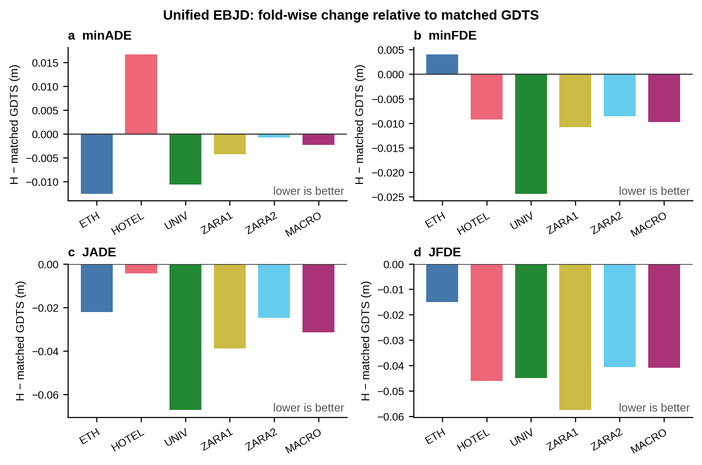
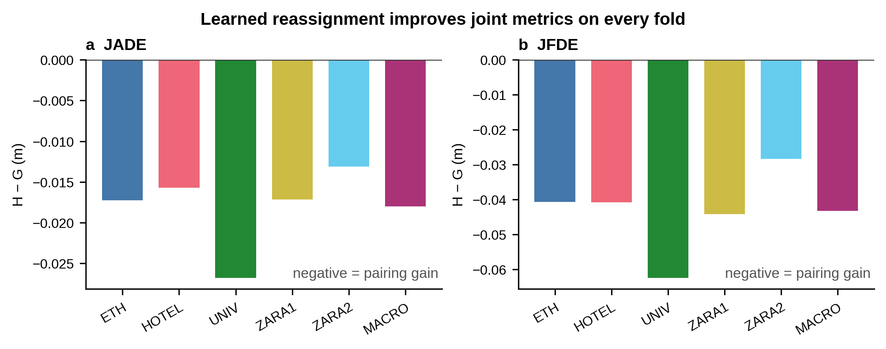
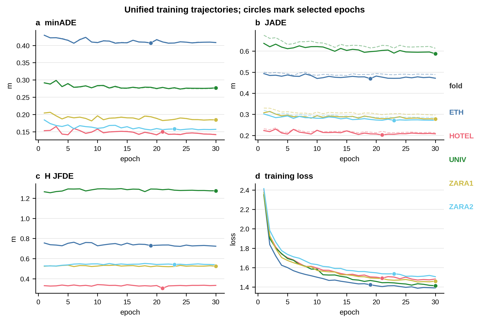

# EBJD 统一方案 ETH/UCY 五折正式结果汇总

## 结论先行

- **五折已全部完成。** ETH、HOTEL、UNIV、ZARA1、ZARA2 均有同一选中 checkpoint 的 2035–2039 五个推理 seed，matched GDTS、G、H 三条完整轨迹结果齐全。
- **H 相对 matched GDTS 的五折等权宏平均四项均改善：** minADE `−0.002295 m`（`+0.97%`）、minFDE `−0.009789 m`（`+2.67%`）、JADE `−0.031439 m`（`+7.98%`）、JFDE `−0.040814 m`（`+5.68%`）。负差值表示 H 更低。
- **单折四指标合同通过 3/5：** UNIV、ZARA1、ZARA2 通过；ETH 因 minFDE 退化 `0.004054 m` 失败；HOTEL 因 minADE 退化 `0.016736 m`（`12.45%`）失败。宏平均通过不能改写这两个单折 FAIL。
- **配对的指标证据在五折均成立：** H 相对 G 的 JADE、JFDE 在每折均为 `5/5` 推理 seed 改善，minFDE 每折均为 `5/5` 完全相同。ZARA1/ZARA2 还有明确的候选集合保持收据；ETH/HOTEL/UNIV 未找到独立的全 bank 集合等价收据，因此只能报告“实现约束＋指标一致”，不能用 minFDE 相同替代集合验证。
- **主要剩余短板是折相关的边缘路径精度，而不是学习配对的联合收益不稳定。** HOTEL 的 minADE 问题在 G 已存在，H 仅小幅改善；ETH 的 minFDE 在 G 和 H 完全相同。二者都不是 H 配对新引入的问题。

## 1. 纳入范围与证据身份

主表只纳入冻结可靠终点先验、可学习联合配对、未来交互条件桥的统一方案：`192/4/768`、6 个 FJAB、FULL/Raw、20 worlds、20 DDIM steps、rollout/projection OFF。没有混入旧 HOTEL epoch45、旧 UNIV epoch73/81、ETH native-goal/anchor/gamma 或旧多阶段 Candidate。

| Fold | 选中身份 | Epoch | Updates | Checkpoint SHA256 | Source commit |
|---|---:|---:|---:|---|---|
| ETH | best_jade | 19 | 7,710 | `48dc2144fb20cb3e678eed7b7df793598fe8f2ac0eda7a026b4bcf1696626b97` | `e4b526d8af8cad02937ab04a9090f96cb2450497` |
| HOTEL | best_jade | 21 | 7,980 | `68119ee66d552c75fddf501522e896e8582dcb646e9edd58e6fdc48ea8c1b122` | `7801d4fcf8f89416510bbb2e96258be0f5d693d8` |
| UNIV | best_eligible | 30 | 7,650 | `39b5fce2b343516b36572df97289079ae00881ab0b380319bd5c10f3474957d3` | `84ff4a68aca768a7f06211b9a758bfc97319c378` |
| ZARA1 | best_eligible | 30 | 8,100 | `062a497c7baa28bfe88cf7e559784ad7029e979ddf93f3e0f8b08baa4713214b` | `9bf9e71b0da74e69f3bca9add6833c39b51f1642` |
| ZARA2 | best_eligible | 23 | 7,530 | `1dcdf54a2ea8081ee21480f1bc7a0499b89dff5a8ccc2c99357f9dd01243c3be` | `5369f589a8b4ad89735b4028e237bede53d35771` |

所有折训练 30 epochs、单一 training seed 3101。五个 seed 是同一训练 checkpoint 的推理随机重复，不是五个训练 seed。各折源码提交不同，差异来自顺序开展时的 fold/provider 接入和运行工程修复；绑定配置中的方法签名一致。ZARA1 的 `model_config.json` 仍带旧基配置的 250 epochs 和 `lr_final_fraction=0.01`，但实际运行由 `training_contract.yaml`、RUN_IDENTITY 与 30 轮完整日志共同绑定为统一 30 轮合同；此处属于配置打包不整齐，不据此改变实际实验身份。

各折 validation/test 都登记为官方数据包内部的镜像成员，因而这些结果是当前冻结内部协议下的正式比较，不应被表述为两个彼此独立的数据划分。

## 2. 五折正式主表

数值全部由逐 seed 原始结果重算；`±` 后为五个推理 seed 的样本标准差（ddof=1）。

| Fold | Method | minADE | minFDE | JADE | JFDE |
|---|---|---:|---:|---:|---:|
| ETH | GDTS | 0.415750±0.005153 | 0.577091±0.010063 | 0.492722±0.004842 | 0.749165±0.008598 |
|  | G | 0.403412±0.003935 | 0.581145±0.008046 | 0.487877±0.004845 | 0.774792±0.009910 |
|  | H | 0.403168±0.004216 | 0.581145±0.008046 | 0.470615±0.003654 | 0.734140±0.011278 |
| HOTEL | GDTS | 0.134384±0.001351 | 0.191589±0.002872 | 0.208469±0.002341 | 0.357055±0.004002 |
|  | G | 0.151516±0.002129 | 0.182367±0.002250 | 0.219791±0.001521 | 0.351718±0.003011 |
|  | H | 0.151120±0.002097 | 0.182367±0.002250 | 0.204081±0.001272 | 0.310963±0.003344 |
| UNIV | GDTS | 0.287524±0.000222 | 0.521531±0.000496 | 0.654875±0.000979 | 1.319015±0.000891 |
|  | G | 0.275451±0.000239 | 0.497151±0.000367 | 0.614602±0.001195 | 1.336550±0.003004 |
|  | H | 0.276907±0.000257 | 0.497151±0.000367 | 0.587826±0.001040 | 1.274130±0.001825 |
| ZARA1 | GDTS | 0.188556±0.001004 | 0.285608±0.001405 | 0.318124±0.002240 | 0.585493±0.004152 |
|  | G | 0.184812±0.000424 | 0.274816±0.000666 | 0.296446±0.001098 | 0.572203±0.003532 |
|  | H | 0.184314±0.000317 | 0.274816±0.000666 | 0.279281±0.001438 | 0.528041±0.002193 |
| ZARA2 | GDTS | 0.158421±0.000305 | 0.257847±0.001030 | 0.295602±0.001261 | 0.582360±0.002315 |
|  | G | 0.157844±0.000532 | 0.249244±0.000676 | 0.283911±0.000874 | 0.570115±0.002664 |
|  | H | 0.157652±0.000473 | 0.249244±0.000676 | 0.270794±0.000967 | 0.541744±0.001152 |
| **五折等权宏平均** | **GDTS** | **0.236927±0.001055** | **0.366733±0.002184** | **0.393959±0.001218** | **0.718617±0.001965** |
|  | **G** | **0.234607±0.000469** | **0.356945±0.002006** | **0.380526±0.000766** | **0.721075±0.001797** |
|  | **H** | **0.234632±0.000487** | **0.356945±0.002006** | **0.362519±0.000380** | **0.677804±0.002755** |

宏平均严格按 seed 先跨五折等权平均，再对五个宏 seed 求均值和样本标准差；没有直接平均各折 SD，也没有将 25 条记录当成独立训练。

## 3. 最终性能合同

| Fold | minADE | minFDE | JADE | JFDE | 四项合同 |
|---|---:|---:|---:|---:|---:|
| ETH | PASS (`−0.012583`) | **FAIL (`+0.004054`)** | PASS (`−0.022107`) | PASS (`−0.015025`) | **FAIL** |
| HOTEL | **FAIL (`+0.016736`)** | PASS (`−0.009223`) | PASS (`−0.004389`) | PASS (`−0.046092`) | **FAIL** |
| UNIV | PASS (`−0.010616`) | PASS (`−0.024380`) | PASS (`−0.067049`) | PASS (`−0.044885`) | **PASS** |
| ZARA1 | PASS (`−0.004242`) | PASS (`−0.010792`) | PASS (`−0.038844`) | PASS (`−0.057452`) | **PASS** |
| ZARA2 | PASS (`−0.000769`) | PASS (`−0.008603`) | PASS (`−0.024808`) | PASS (`−0.040616`) | **PASS** |
| 五折宏平均 | PASS (`−0.002295`) | PASS (`−0.009789`) | PASS (`−0.031439`) | PASS (`−0.040814`) | **PASS（仅宏平均）** |

括号为 `H−GDTS`，单位米。ETH/HOTEL 仍是原合同 FAIL；`best_jade` 也不能解释成 `best_eligible`。

## 4. 配对机制

| Fold | H−G minADE（改善 seed） | minFDE | H−G JADE | H−G JFDE | 联合指标方向 |
|---|---:|---:|---:|---:|---:|
| ETH | −0.000244（4/5） | 0（5/5相同） | −0.017262（5/5） | −0.040652（5/5） | 一致改善 |
| HOTEL | −0.000396（3/5） | 0（5/5相同） | −0.015711（5/5） | −0.040755（5/5） | 一致改善 |
| UNIV | +0.001456（0/5） | 0（5/5相同） | −0.026776（5/5） | −0.062419（5/5） | 联合改善、minADE权衡 |
| ZARA1 | −0.000498（5/5） | 0（5/5相同） | −0.017166（5/5） | −0.044161（5/5） | 一致改善 |
| ZARA2 | −0.000192（5/5） | 0（5/5相同） | −0.013117（5/5） | −0.028370（5/5） | 一致改善 |
| 五折宏平均 | +0.000025 | 0 | −0.018006 | −0.043271 | 联合改善、minADE近零权衡 |

因此，学习配对的稳定贡献是**联合 world 组织**：五折 JADE/JFDE 均下降，且每折都是 5/5 推理 seed 同向。它没有改善终点覆盖指标 minFDE；宏平均 minADE 也没有收益，UNIV 上还存在明确代价。论文应将配对贡献限定为联合一致性收益，而不是边缘精度的普遍提升。

## 5. 问题位于哪个环节

1. **G 相对 GDTS。** 五折宏平均中，G 的 minADE、minFDE、JADE 分别改善 `0.002320/0.009789/0.013433 m`，但 JFDE 退化 `0.002458 m`。可靠终点＋直接条件桥已经改善边缘精度和部分联合路径质量，但没有独立解决联合终点组织。
2. **H 相对 G。** H 将宏平均 JADE/JFDE 再降低 `0.018006/0.043271 m`，且 minFDE 完全保持；这正是当前配对机制最清楚的贡献。
3. **HOTEL。** G 的 minADE 已比 GDTS 高约 `0.017132 m`，H 反而小幅降低 `0.000396 m`。因此 `12.45%` 的最终 minADE 退化是 G/H 共有的路径精度问题，不能归咎于配对。
4. **ETH。** G 与 H 的 minFDE 完全相同，且都比 GDTS 高 `0.004054 m`。统一方案已缓解历史困难——minADE、JADE、JFDE 均优于 GDTS——但没有恢复终点边缘合同。
5. **UNIV。** 新统一 H 四项均优于 matched GDTS；配对将 G 原本较差的 JFDE 从 `1.336550` 降至 `1.274130`，代价是 minADE 相对 G 增加 `0.001456 m`。旧 epoch73/81 不进入这张统一主表。

这些汇总只能定位“终点/路径边缘”与“联合配对”之间的现象边界，不能仅凭四项指标推断过拟合、噪声坍缩、中心偏移、碰撞变化或具体因果机制。

## 6. 训练曲线与选模

五折逐 epoch 日志齐全。图中圆点是原 selector 已经冻结的 epoch；本次没有重选 checkpoint。G/H minADE、JADE、H-JFDE 与 loss 均按原日志绘制。

## 7. 成本

| Fold | Provider/候选准备 | 主训练＋逐轮验证 | 最终五 seed | 流水线记录总GPU墙钟 | Selected/total epochs |
|---|---:|---:|---:|---:|---:|
| ETH | 0.58 h | 7.98 h | 0.20 h | 8.80 h | 19/30 |
| HOTEL | 0.33 h | 8.87 h | 0.35 h | 9.60 h | 21/30 |
| UNIV | 0.74 h | 10.47 h | 0.89 h | 12.12 h | 30/30 |
| ZARA1 | 未单列 | 8.49 h | 0.55 h | 9.06 h | 30/30 |
| ZARA2 | 0.98 h | 11.35 h | 0.81 h | 13.26 h | 23/30 |

五折当前流水线收据合计约 `52.84 GPU h`。Provider 列按预算收据中明确的 parity/export 阶段统计，包含收据记录的失败或继承尝试；ZARA1 没有独立分项，因此不以总额差值猜测。历史 matched GDTS/先验训练成本不在当前统一流水线收据中，标记为未知；缓存 bank 评测耗时也不等同于完整在线推理延迟。

## 8. 证据边界

### 数据支持

- 五折宏平均上，H 四项均低于 matched GDTS。
- 单折中 3/5 通过四项不退化合同。
- H 相对 G 的 JADE/JFDE 在所有折、所有五个推理 seed 上方向一致；minFDE 完全保持。
- HOTEL/ETH 的失败项在 G 已经存在，不是 H 配对造成。

### 尚未解决

- HOTEL 的路径 minADE 明显落后；ETH 的终点 minFDE 小幅落后。
- UNIV 配对存在 minADE 与联合指标的权衡。
- 当前每折只有一个训练 seed，不能评价训练随机性的稳定性。
- 只有 ZARA1/ZARA2 有明确的候选集合保持文字收据；其他三折缺少独立全 bank 集合等价验证。
- 本轮没有现成逐行人/逐场景 bank，因此没有补做 N=1/N≥2 或人数分组分析。

### 目前不能宣称

- 不能称为统计显著、所有折全面超越或所有指标不退化。
- 不能把推理 seed 的低标准差解释为多训练 seed 稳定性。
- 不能从汇总指标单独归因具体结构机制或碰撞行为。

## 9. 唯一下一步建议

**优先补训练种子，而不是继续加模块。** 当前已经有完整五折、清楚的宏平均收益和跨折一致的配对联合收益，但证据仍全部来自每折一个训练 seed；在进入论文消融或继续结构修改前，至少对关键代表折补独立训练 seed，确认宏结论与 HOTEL/ETH 的边缘失败不是单次训练初始化的偶然结果。

## 10. 适合论文使用的准确表述

> 在统一的五折内部评测协议下，EBJD 的学习重配版本 H 相对 matched GDTS 在五折等权宏平均上降低了 minADE、minFDE、JADE 和 JFDE，降幅分别为 0.97%、2.67%、7.98% 和 5.68%。单折四指标不退化合同在 UNIV、ZARA1 和 ZARA2 上成立，但 ETH 的 minFDE 与 HOTEL 的 minADE 仍未通过。相对使用同一终点候选的 G，H 在所有五折的五个推理 seed 上均降低 JADE/JFDE，并保持 minFDE；这些结果支持学习配对对联合 world 组织的贡献，但不构成多训练种子稳定性或统计显著性的证据。

## 11. 可复核文件

- `SOURCE_MANIFEST.json`：路径、哈希、checkpoint、manifest、配置与证据身份。
- `PER_SEED_METRICS.csv`：75 行原始方法级记录（5 folds × 5 seeds × 3 methods）。
- `FIVEFOLD_METRICS.csv`：逐折及五折宏平均的均值和 ddof=1 标准差。
- `CONTRACT_SUMMARY.json`：逐项合同、差值、改善率及 seed 方向计数。
- `COMPUTE_COSTS.csv`：成本收据汇总。
- `build_summary.py`、`plot_results.py`：CPU 重算和绘图入口。

