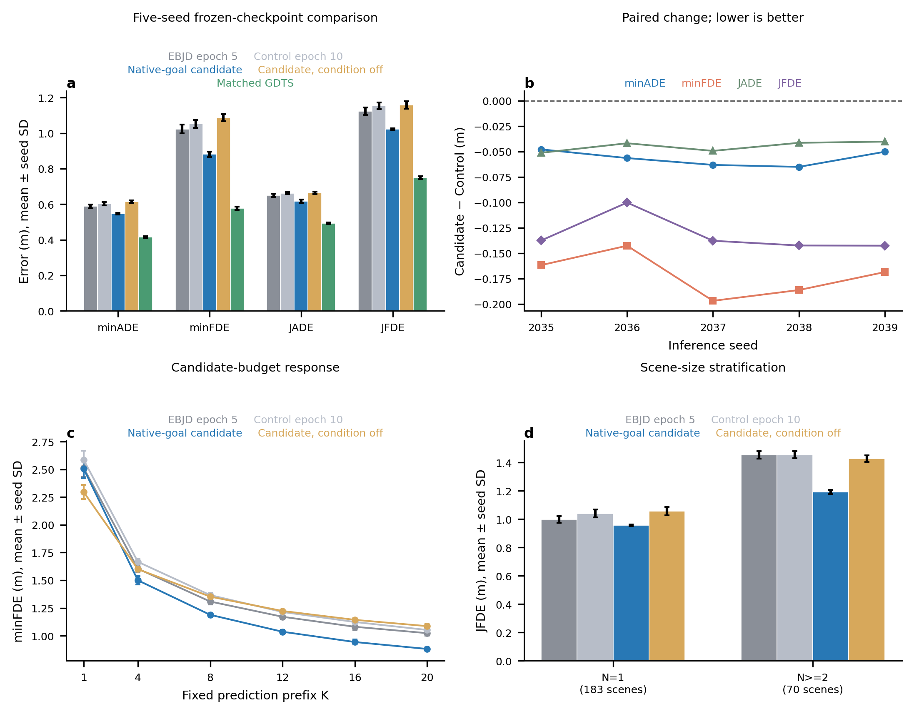
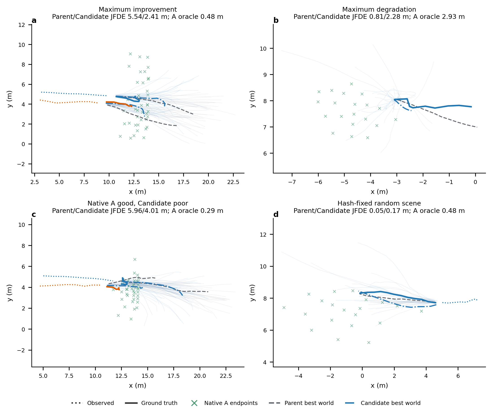

# EBJD ETH 原生目标条件短程实验（2026-10-19）

## 结论

本轮状态为 **`COMPLETE`**，工程门槛、正式配对和五种子评测均完成。原生 GDTS 目标候选通过一个 74,945 参数、零门控初始化的 cross-attention 支路接入 EBJD 后，Candidate 相对配对 Control 的 minADE/minFDE/JADE/JFDE 五种子均值分别改善 **9.38%/16.27%/6.77%/11.44%**，四项指标在 5/5 inference seeds 上均改善；预注册的短程继续研究门槛通过。Candidate 也优于固定父模型 epoch 5 的四项均值。

但 Candidate 仍显著落后 matched GDTS：minADE/minFDE/JADE/JFDE 分别高 **31.49%/52.64%/25.30%/36.47%**。所以本轮支持“原生目标先验确实被 EBJD 使用并改善 ETH 短程结果”，**不支持“ETH 已修复”或“已超过 GDTS”**。唯一建议的下一步是预注册并执行跨 epoch 21 rollout 启用边界的配对验证；本轮不自动执行。

> 边界：训练种子只有 3101；2035–2039 是同一冻结 checkpoint 的采样种子，不是五个独立训练重复。validation 与 test 是镜像，`independent_test=false`，不得据此声称独立测试泛化或统计显著性。

## 实现与数据流

```text
完整场景语义图 + 8 帧观测
  → 冻结 matched GDTS goal_module
  → 原生 TTST（20 centres，排除额外 argmax）
  → 世界坐标候选 G[N,20,2]，离线身份绑定缓存
  → [(g-o)/s_g, (g-cv)/s_g] → MLP 4→64→128
  → LN(hidden) 对同一行人的 20 个候选做 4-head cross-attention
  → hidden + tanh(λ)·condition
  → 原 EBJD 六个 future blocks、goal/bridge heads 与 sampler
```

条件支路只在初始 hidden 后、第一个 coarse block 前注入一次；原 72-token memory softmax、goal latent、bridge latent、四个预测头和最终 endpoint 均未替换。候选只来自语义图与历史，provider manifest 明确记录 `future_consumed_by_provider=false`。实现位置包括 `ebjd/denoiser.py` 的 `NativeGoalConditioner`、`ebjd/data.py` 的 `NativeGoalBank`、`scripts/export_native_gdts_goal_bank.py` 的原生 A 路径，以及 `ebjd/trainer.py` 的显式模型扩展迁移。

## 身份与门槛

| 项目 | 绑定/结果 |
|---|---|
| 实现提交 | `6f7a05f718accf322dc0dedb6d024111a115e6f8` |
| ETH held-out manifest | `03f9b6bef89d43137b31782bbf0eb5b16d19f8ddfe378e2c7c62e700e128397b`；253 scenes / 364 agent occurrences |
| 父 checkpoint | epoch 5/update 1285；`a5f45606329b80754567cf86381ceff0d19e68c8eaddf999c74f71ef1bdde525` |
| matched GDTS / provider | `126acf2a34f52986c536c397fe3acb04c769a3cde95077461d7971a1b0792950` |
| train bank | seed 3101；4110 scenes / 36,906 agent occurrences；manifest `55fc2fb…cc78` |
| A 路径重放 | seed 2035 native oracle FDE `0.574714`，与三臂 A 精确一致 |
| 零 gate FP32 | 最大绝对误差 `0`，逐位相同 |
| 零 gate CUDA/BF16 | 最大绝对误差 `0`，逐位相同 |
| 候选置换 | FP32 最大误差 `4.19e-9`（容差 `2e-6`）；BF16 为 `0`（容差 `2e-3`） |
| 模型扩展迁移 | 原模型/按名称 optimizer state/RNG/update 均精确；新状态为空；二次 strict reload 通过 |
| 正式配对 | 两臂各 1285 updates；epoch/update、场景-行人、增强、随机 draw、LR、rollout/projection 12 项逐更新零分歧 |
| Control epoch 10 | `fb6a90bb1a97c05919f249d09832f181b5ded21cca9759f996cc7ec8a67b99e8` |
| Candidate epoch 10 | `b339ab96c288fe0757d2bce75f6408fa80dfde3b030a1109af68b4a760aa4f12` |

正式 v4 之前，首次 Candidate v3 在第一个 optimizer update 前暴露了新增参数的空 optimizer state 被序列化为 `{}`、但自定义 ActualStepAdamW 只接受 `None` 的问题。该问题在产生正式 update 前修复并增加回归测试；随后 Control 与 Candidate 均从同一父边界按新 v4 身份完整重跑。因此 v3 不进入任何数值结论。

## 五种子正式结果

全部为同一 ETH JMM held-out mirror、P20、20 DDIM steps、eta=0、FP32 EBJD 推理；数值为 metre，越低越好。

| 方法 | minADE | minFDE | JADE | JFDE |
|---|---:|---:|---:|---:|
| EBJD epoch 5 | 0.587924 ± 0.010845 | 1.023315 ± 0.023947 | 0.648937 ± 0.009628 | 1.123946 ± 0.021509 |
| Control epoch 10 | 0.603252 ± 0.009777 | 1.052079 ± 0.022038 | 0.662213 ± 0.005784 | 1.154474 ± 0.018302 |
| **Candidate epoch 10** | **0.546688 ± 0.005061** | **0.880894 ± 0.016125** | **0.617377 ± 0.008819** | **1.022390 ± 0.004896** |
| Candidate checkpoint，condition off | 0.615360 ± 0.006742 | 1.086649 ± 0.019579 | 0.664124 ± 0.007463 | 1.159252 ± 0.020844 |
| matched GDTS | **0.415750 ± 0.005153** | **0.577091 ± 0.010063** | **0.492722 ± 0.004842** | **0.749165 ± 0.008598** |

均值后为五个 inference seeds 的样本标准差。GDTS 采用自身原生采样与 BF16 CUDA autocast，seed 标签相同但随机流/模型协议不能逐元素配对；它是相同 scene manifest 与指标定义下的方法级对照。

Candidate 每个 seed：

| seed | minADE | minFDE | JADE | JFDE |
|---:|---:|---:|---:|---:|
| 2035 | 0.545631 | 0.887919 | 0.608005 | 1.018551 |
| 2036 | 0.549176 | 0.895419 | 0.616000 | 1.023643 |
| 2037 | 0.539568 | 0.873500 | 0.611806 | 1.020256 |
| 2038 | 0.553292 | 0.891489 | 0.630883 | 1.030401 |
| 2039 | 0.545771 | 0.856140 | 0.620193 | 1.019098 |

### 配对差值

| 比较 | ΔminADE | ΔminFDE | ΔJADE | ΔJFDE | 解释 |
|---|---:|---:|---:|---:|---|
| Candidate − Control | −0.056565 | −0.171185 | −0.044835 | −0.132084 | 四项均 5/5 seeds 改善；筛选门槛通过 |
| Candidate − epoch 5 | −0.041236 | −0.142422 | −0.031559 | −0.101556 | 四项均值和 5/5 seeds 改善 |
| Candidate − condition off | −0.068672 | −0.205755 | −0.046747 | −0.136862 | 冻结 checkpoint 对条件支路有明确敏感性；不替代独立 Control |
| Candidate − matched GDTS | +0.130937 | +0.303803 | +0.124656 | +0.273225 | 原始合同失败 |

## 分层、预算曲线与覆盖诊断

Candidate 在单人和多人场景均优于 Control，但多人收益更强：

| 分层 | scenes / agents | Candidate minFDE | 相对 Control | Candidate JFDE | 相对 Control |
|---|---:|---:|---:|---:|---:|
| N=1 | 183 / 183 | 0.957447 | −7.90% | 0.957447 | −7.90% |
| N≥2 | 70 / 181 | 0.803494 | −24.53% | 1.192169 | −18.05% |

固定 P20 bank 的前缀 K 曲线中，Candidate minFDE 从 K=1 的 `2.505668` 单调下降至 K=4/8/12/16/20 的 `1.499818/1.188717/1.036101/0.943374/0.880894`。这是固定候选顺序预算曲线，不等于重新运行原生 TTST(K)。

| Candidate 诊断（五种子均值） | 数值 |
|---|---:|
| diffusion endpoint recall@0.5m / @1.0m | 45.66% / 69.56% |
| native A recall@0.5m / @1.0m | 64.40% / 87.75% |
| diffusion oracle minFDE / native A oracle FDE | 0.880894 / 0.578900 |
| minFDE P90 / P95 | 2.075071 / 2.743888 |
| 平均单候选 FDE | 2.500183 |
| 候选中心误差（20 个预测 endpoint 均值到 GT） | 1.990443 |
| 中心化 RMS（相对候选自身均值） | 1.671642 |
| 候选两两平均距离 | 2.091756 |
| native / diffusion 相对 CV endpoint 的平均半径 | 2.570423 / 1.858048 |

相对 epoch 5，Candidate 的 endpoint 中心误差从 `2.1315` 降至 `1.9904`，中心化 RMS 从 `1.4401` 增至 `1.6716`，P95 从 `3.4123` 降至 `2.7439`。这支持“目标条件同时改善中心位置并扩大有效覆盖”的有限解释。仍有明显的先验利用缺口：native A oracle 为 `0.5789`，最终 diffusion oracle 为 `0.8809`，且 diffusion 相对 CV 的半径仍小于 native A。固定案例也存在最大退化 `1.4717 m`，不能把总体改善解释为每个窗口都受益。



固定案例按预先明确的机械规则选择：seed 2035 的最大 JFDE 改善、最大退化、native A oracle≤0.5m 中 Candidate JFDE 最大者，以及对其余 scene id 做固定 SHA256 排序的首项。图中浅色为全部 20 worlds，粗线为按 scene JFDE 选出的 best world；该 best-world 显示仅用于说明已计算指标，不参与训练或重新评估。



## Gate、训练与成本

- Gate 从严格 `0` 开始，第一次正式 update 后为 `9.9972e-5`，epoch 10 最终为 `0.0593082`；1285/1285 正式 updates 的 gate 梯度均有限且非零。
- 最终条件支路范数 / 原 hidden 范数为 `0.150652`。condition-off 五种子显著退化，说明模型在冻结终点的干预下确实依赖该支路；这不是独立训练消融，不能独自证明全部增益归因。
- 两臂均完成 epoch 6–10，各 1285 updates，rollout updates 均为 0，符合 epoch 21 才启用的合同。
- Control/Candidate 正常 update 平均 `1.9406/1.9972 s`，Candidate 增加约 `2.91%`；峰值 CUDA allocated 为 `3.568/3.575 GB`（约增加 6.94 MB）。包含验证和 I/O 的五轮 wall time 为 `3796.0/3894.9 s`。
- train prior bank 生成 `743.5 s`；五个 held-out prior banks 合计 `45.3 s`。这是离线一次性成本，不能因 NFE 不变而忽略。
- 两者均为 20 NFE。由连续 bank 完成时间戳估计，253 scenes 完整 FP32 推理加压缩写盘为 Control `71.75 s/seed`、Candidate `75.71 s/seed`，约增加 `5.52%`；这是实际运行完成间隔，不是同步 CUDA kernel benchmark。matched GDTS 工具内计时为 `111.65 ± 2.27 s/seed`。

## 审查结论

### 已确认

- cache 绑定 scene/frame/agent/history hash；缺失、hash 不符或错位会失败，没有静默回退。
- provider 只接收历史和地图，权重冻结、eval、无 optimizer update；额外 argmax 被排除，候选单位为 metre。
- 候选随训练的旋转/平移进行同一等变变换；padding、compaction、slice/pack 均携带候选。
- 新支路在训练时即使 gate=0 仍执行，因此 gate 可获梯度；零 gate 在实际 CUDA FP32/BF16 路径均逐位兼容。
- 旧参数和 optimizer moments 按名称迁移，新参数首次 actual-step 状态正确初始化；普通 strict resume 未放宽。
- 正式两臂的训练数据与随机输入逐 update 完全配对。

### 本轮支持

- 强 endpoint proposal 并非“接进来也没用”：软条件支路被学习、被使用，并在早期无 rollout 区间改善 marginal 与 joint 指标。
- 多人 JFDE 的改善比 N=1 更大，但这仍是单训练种子结果，不能升级为交互机制创新结论。
- 结构是低成本修复支路，不是论文主创新；joint goal+bridge 生成仍由 EBJD 完成。

### 尚未验证

- epoch 21 后 rollout loss 与 native goal condition 是否协同或冲突。
- 多训练种子、真正独立 test、ETH 之外各 leave-one-out 折的效果。
- 长训练是否持续改善、回落或导致候选重新收缩。
- 相对 matched GDTS 的差距能否由这一软条件结构消除；当前证据明确显示不能。

## 交付物

- 全量小型结果与定义：[RESULTS_AND_DIAGNOSTICS.json](validation/eth_native_goal_conditioning_pilot_20261019/RESULTS_AND_DIAGNOSTICS.json)
- 冻结计划及两臂配置：[PILOT_PLAN.json](validation/eth_native_goal_conditioning_pilot_20261019/PILOT_PLAN.json)、[CONTROL_CONFIG.json](validation/eth_native_goal_conditioning_pilot_20261019/CONTROL_CONFIG.json)、[CANDIDATE_CONFIG.json](validation/eth_native_goal_conditioning_pilot_20261019/CANDIDATE_CONFIG.json)
- CUDA 兼容性收据：[COMPATIBILITY_RECEIPT.json](validation/eth_native_goal_conditioning_pilot_20261019/COMPATIBILITY_RECEIPT.json)
- 图、source data 与 QA：[validation/eth_native_goal_conditioning_pilot_20261019/](validation/eth_native_goal_conditioning_pilot_20261019/)
- 完整执行命令：[COMMANDS.md](validation/eth_native_goal_conditioning_pilot_20261019/COMMANDS.md)

Checkpoint、完整预测 bank、候选 cache、数据 shard 和大日志只保留在本地绑定路径，未提交仓库。
