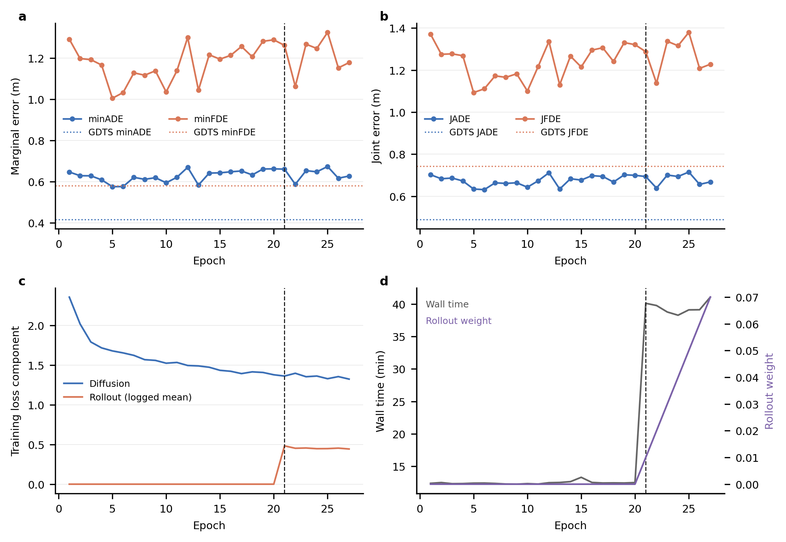

# ETH 定向诊断：CPU 完成，冻结 bank 待 GPU 空闲

## 首页结论

本轮严格执行了 **0 次 optimizer update、0 个新训练实验、0 次模型 forward、0 GPU-active time**，没有停止、重启或修改正在运行的 ETH 训练。状态为 `CPU_COMPLETE_GPU_PENDING`，不能标成 `FULL_DIAGNOSTIC_COMPLETE`。

| 问题 | 证据 | 判断 | 下一步 |
| --- | --- | --- | --- |
| 方法级差距在数值 parity 后是否仍存在？ | 两套实际 evaluator 在 253 个真实 ETH 窗口的同一 CV prediction tensor 上通过；最大绝对差 `9.537e-7 m`。已有 matched 指标仍是 GDTS `0.4171/0.5800/0.4899/0.7434`、EBJD epoch 5 `0.5761/1.0050/0.6343/1.0931` | **CONFIRMED**：未发现可解释方法差距的指标算术错误；模型 bank 的逐窗口回放仍待完成 | 冻结导出三份 P20 bank 后核对 replay |
| 单人/多人哪组贡献了多少退化？ | 已确认 183 个 N=1 窗口、70 个 N>=2 窗口；CV 分层已重算，但不存在完整模型 bank | **OPEN**：不能用人口比例代替 EBJD−GDTS 的真实组贡献 | 对 bank 做 agent-weighted marginal 与 scene-weighted joint 的可加分解 |
| 主导证据指向哪里？ | goal RMS `1.95x`、bridge RMS `2.41x`；中位数与 P90/P95 同时上移 | **SUPPORTED_BUT_NOT_CAUSAL**：广泛的 endpoint/bridge 分布偏移成立；中心偏差、under-dispersion、候选覆盖和模型重尾仍未闭环 | 在同一 bank 上同时计算中心、半径、nearest-of-20 与 K 曲线 |
| 继续到下一观察点解决什么，成本多少？ | rollout 从 epoch 21 开始、epoch 40 ramp 完成；epoch 21–27 平均约 `39.45 min/epoch` | **SUPPORTED_BUT_NOT_CAUSAL**：到 epoch 40 只检验计划内 rollout 阶段趋势，不能识别 sampler/scale 因果；从 epoch 27 边界约 `8.55 h` | `REVIEW_AT_NEXT_MILESTONE`，不自动停止或改计划 |

**唯一最高优先级行动：**当前 ETH 训练自然释放 GPU 后，导出 matched GDTS、EBJD epoch 5 和不可变 epoch 27 的 seed-2035/P20 bank，并运行已经实现的 CPU 分解。取得这项证据前，不改 scale、sampler、网络或训练目标。

## 快照与边界

读取边界时，训练已完成 epoch 27 / update 6939，epoch 28 正在追加；计划为 100 epochs / 25,700 updates。`PIPELINE_STATE.json` 的 `active_epoch=1` 是 goal-pretrain 遗留字段，当前活动 epoch 以 append-only `train.jsonl` 的完整记录推得。

| 资产 | 绑定 |
| --- | --- |
| 固定归档证据 | `ebbbe189a258ed161be97e26e29fecb53acf467f` |
| 正式训练源码 | `d266681b7f08940f6caf5c20a01b41bb867b70b7` |
| pipeline orchestration | `092ed91f1f4117f50aa835ec8e47cd2c9ce74a98` |
| JMM validation manifest | `03f9b6bef89d43137b31782bbf0eb5b16d19f8ddfe378e2c7c62e700e128397b` |
| resolved config | `936924d8b773f61e9fc5e419fdc0e939bd369beb155c4e74474924ae727214a9` |
| GDTS checkpoint | `126acf2a34f52986c536c397fe3acb04c769a3cde95077461d7971a1b0792950` |
| GDTS config | `1906d36c39512de376359a890473de7f5678ec165d07344b47e41305b3a3481c` |
| EBJD epoch 5 | `a5f45606329b80754567cf86381ceff0d19e68c8eaddf999c74f71ef1bdde525` |
| EBJD epoch 27 | `1b3de8d31c580640efabe12fa34b5bfb27e23ec509a6bd6f6a597c58eb757874` |

本次 `train.jsonl` 读取到 byte `12,376,332`，含 7,072 条完整 JSON 记录，前缀 SHA256 为 `230ddfdd5fca0a5ba3bfc3169a0a8f206f29b65e44423d2a011d71f2755662fc`。`EPOCH_SUMMARY.jsonl` 读取到 byte `26,285`，含 27 条完整 epoch 记录，前缀 SHA256 为 `6f1d8b40b065c045ff5dda809a204c189df9fcc9b37c2fcf20ae9f5e8bc5a597`。后续日志追加不改变本报告的边界。

## 1. 同一 prediction tensor 的 evaluator parity

实际接线为：EBJD `[B=1,P=20,N,T=12,2]`；GDTS `[P=20,T=20,N,2]`，前 8 帧为 observation prefix；真实窗口没有 padding。marginal 按 agent occurrence 聚合，joint 按 scene window 聚合。

| 数量 | 最大绝对差（m） | 最大相对差 |
| --- | ---: | ---: |
| 每 agent/world ADE | `9.537e-7` | `2.472e-7` |
| 每 agent/world FDE | `0` | `0` |
| agent minADE | `9.537e-7` | `2.472e-7` |
| agent minFDE | `0` | `0` |
| scene marginal ADE/FDE | `4.768e-7 / 0` | `2.362e-7 / 0` |
| JADE/JFDE | `4.768e-7 / 0` | `2.485e-7 / 0` |

初始容差 `atol=1e-6 m, rtol=1e-5` 未调整，首个失败位置为 `null`。真实 N=1 的 joint−marginal 最大差为零。

合成非退化核验也通过：整场景 world 同步重排差为零；agent 轴同步重排差为零；逐 agent 独立重排保持 marginal 不变而 joint ADE/FDE 各变化 `5 m`；padding 对有效 agent 的最大影响为零。因此 **NOT_FOUND_IN_CHECKED_SCOPE：没有发现 metric 公式或轴接线错误**。

注意：此 parity 使用真实 ETH 的窗口形状、GT 和 CV prediction tensor，不是模型 prediction bank 的回放。它足以检验两套指标数值实现，但不替代 checkpoint→sampler→bank 的完整复现。

## 2. 已有方法级结果与缺失的组贡献

所有数值来自相同 JMM-253、P20、20 steps、selection seed 2035，单位为米；同一行是同一 checkpoint，未拼接不同 epoch 的单项最优值。

| 模型 | minADE | minFDE | JADE | JFDE |
| --- | ---: | ---: | ---: | ---: |
| matched GDTS | 0.417053 | 0.580032 | 0.489907 | 0.743412 |
| EBJD epoch 5 | 0.576088 | 1.004969 | 0.634319 | 1.093059 |
| EBJD epoch 27 | 0.627731 | 1.178231 | 0.668176 | 1.227863 |

N=1 有 183 scenes / 183 agents；N>=2 有 70 scenes / 181 agents。由于磁盘上没有三模型的完整 prediction payload，本轮没有生成伪造的模型分层表，也没有把整体 coordination gap 倒推出真实逐组结果。以下项保持 **OPEN**：

- N=1 与 N>=2 对 EBJD−GDTS 总 marginal/joint 差距的可加贡献；
- 多人组是否同样落后；
- 组内 P90/P95 与最差 5% 是否主导总差距；
- epoch 26 的多人 coordination gap 推导值是否由真实 payload 复现。

## 3. CV 基线与 latent 分布

CV 严格复用“最近两段观测速度的平均，再外推 12 步”，没有读取未来做平滑或调参。它是一条确定性轨迹，没有伪装成 20 个不同候选。

| 分组 | scenes | agents | minADE | minFDE | JADE | JFDE |
| --- | ---: | ---: | ---: | ---: | ---: | ---: |
| overall | 253 | 364 | 1.041343 | 2.223554 | 1.080740 | 2.242192 |
| N=1 | 183 | 183 | 1.121888 | 2.270594 | 1.121888 | 2.270594 |
| N>=2 | 70 | 181 | 0.959908 | 2.175994 | 0.973167 | 2.167941 |

CV 只能说明观察运动的外推难度。要回答 EBJD 对哪些病例帮助或损害，仍需模型 bank；不能拿 CV 与模型的非配对聚合均值代替逐病例差。

### 分布变化不是只在极端尾部

| 量 | train 中位数 / P90 / P95 | ETH 中位数 / P90 / P95 |
| --- | --- | --- |
| CV endpoint residual（m） | 0.868 / 2.419 / 3.071 | 1.623 / 4.786 / 5.761 |
| bridge agent RMS（m） | 0.145 / 0.326 / 0.403 | 0.419 / 0.744 / 0.910 |
| future displacement（m） | 2.595 / 5.746 / 6.385 | 2.881 / 9.714 / 10.773 |
| observed speed（m/s） | 0.573 / 1.235 / 1.372 | 0.970 / 2.289 / 2.420 |

整体 goal RMS 从 `1.059668 m` 增至 `2.071457 m`（`1.9548x`），bridge RMS 从 `0.207774 m` 增至 `0.500010 m`（`2.4065x`）。均值、中位数和尾部分位数均移动，所以“只由少数退化异常窗造成”与本次统计不符。它支持分布偏移与泛化困难的关联，但本轮没有改 scale，不能写成 scale 的因果收益证据。

N=1 和 N>=2 的 bridge agent RMS 均值几乎相同（`0.42956/0.42958 m`），但多人 P95 更高（`0.98014 m` 对 `0.63230 m`）；CV residual 的多人 P95 也更高（`7.48076 m` 对 `5.13420 m`）。因此平均尺度变化是广泛的，多人尾部更重。

所有 manifest 窗口的 frame-ID step 为 10，显式 timestamps step 为约 `0.4 s`。这证明当前 manifest 内部的重采样时间是一致的；它不表示任意原始视频 frame stride 10 天然等于 0.4 秒。world↔pixel roundtrip 只能证明变换自洽，不能单独证明外部标定尺度正确。

## 4. 训练阶段趋势



- epoch 1–20（rollout 前）：最优 coherent marginal 是 epoch 5 的 `0.576088/1.004969`，已明显落后 matched GDTS `0.417053/0.580032`。所以主差距早于 rollout。
- epoch 21–27：该段最佳四项均出现在 epoch 22（`0.587402/1.062744/0.638687/1.137477`），没有反超 rollout 前的 epoch 5；epoch 27 为 `0.627731/1.178231/0.668176/1.227863`。
- rollout 前平均约 `12.46 min/epoch`，epoch 21–27 平均约 `39.45 min/epoch`。耗时上升与 rollout 接线一致，但验证波动不能建立 rollout 因果。
- epoch 28–40 尚未完成，不能把未来趋势写成观测事实。到 epoch 40 预计约 8.55 小时，是当前计划中的观察成本，不是性能将反超的承诺。

图采用单个训练 seed，不提供虚假的 uncertainty interval。源代码 preflight 为 19 PASS / 2 WARN / 0 FAIL；panel alignment、PDF 文字下限和最终 PDF collision audit 均通过。两项 warning 分别来自 K 曲线的固定 seeded permutation 关键字和单 seed 聚合，并非模拟训练数据或漏画已有重复实验。

## 5. 为什么冻结分析仍待 GPU

磁盘上存在不可变的 epoch 5、epoch 27 checkpoint，但不存在满足身份、world order、单位与完整覆盖要求的预测 bank。GPU 正被当前 ETH 训练占用；按 prompt 约束没有并发抢占、暂停训练或等待数小时。

已有实测可作预算参考：matched GDTS 全 253 窗口评估为 `110.7 s`；当前 EBJD 每轮完整验证约 `18–20 s`，但 bank 写盘和新增导出器尚未做空闲 GPU smoke，不能把这些数直接当成新导出的精确耗时。下面先提供 8 个固定前缀窗口 smoke，再执行全 253 窗口；三份完整导出仍受 30 分钟 GPU-active 上限约束。

## 6. 可重复执行命令

工作树：

```bash
cd /media/ee615/cede1227-a7b1-4ab4-b6cb-dc50ddd8a336/RSJG/RSJG_EBJD_eth_targeted_diagnostic
```

CPU 部分由 `eth_targeted_diagnostic.py cpu` 完成，归档结果为：

```text
ebjd_clean/docs/diagnostics/eth_targeted_20261015/CPU_RESULTS.json
ebjd_clean/docs/diagnostics/eth_targeted_20261015/TRAINING_TREND.csv
ebjd_clean/docs/diagnostics/eth_targeted_20261015/eth_training_stage.{pdf,svg,png}
```

GPU 空闲后先把以下任一完整命令中的 `--output-root` 暂改为 `.../bank_smoke` 并追加 `--max-scenes 8` 做成本 smoke；通过后使用原命令导出全量。`--confirm-gpu-idle` 是防止与训练并发的显式保护。

### matched GDTS bank

```bash
PYTHONPATH=ebjd_clean /media/ee615/cede1227-a7b1-4ab4-b6cb-dc50ddd8a336/RSJG/.conda/rsjg/bin/python \
  ebjd_clean/scripts/eth_targeted_diagnostic.py export \
  --model gdts \
  --gdts-root /media/ee615/cede1227-a7b1-4ab4-b6cb-dc50ddd8a336/RSJG/RSJG_JDV2_clean \
  --config /media/ee615/cede1227-a7b1-4ab4-b6cb-dc50ddd8a336/RSJG/GDTS/output/eth/config.yaml \
  --checkpoint /media/ee615/cede1227-a7b1-4ab4-b6cb-dc50ddd8a336/RSJG/GDTS/output/eth/saved_models/best_model.pt \
  --manifest /media/ee615/cede1227-a7b1-4ab4-b6cb-dc50ddd8a336/RSJG/RSJG_EBJD_clean/ebjd_clean/data/eth_jmm_official_scene_shards_20261015/validation/validation_manifest.json \
  --output-root /media/ee615/cede1227-a7b1-4ab4-b6cb-dc50ddd8a336/RSJG/RSJG_EBJD_diagnostic_assets/eth_targeted_20261015/banks \
  --expected-checkpoint-sha256 126acf2a34f52986c536c397fe3acb04c769a3cde95077461d7971a1b0792950 \
  --expected-config-sha256 1906d36c39512de376359a890473de7f5678ec165d07344b47e41305b3a3481c \
  --expected-manifest-sha256 03f9b6bef89d43137b31782bbf0eb5b16d19f8ddfe378e2c7c62e700e128397b \
  --seed 2035 --device cuda:0 --confirm-gpu-idle --resume
```

### EBJD epoch 5 bank

```bash
PYTHONPATH=ebjd_clean /media/ee615/cede1227-a7b1-4ab4-b6cb-dc50ddd8a336/RSJG/.conda/rsjg/bin/python \
  ebjd_clean/scripts/eth_targeted_diagnostic.py export \
  --model ebjd \
  --config /media/ee615/cede1227-a7b1-4ab4-b6cb-dc50ddd8a336/RSJG/RSJG_EBJD_clean/ebjd_clean/outputs/formal_eth_main_20261015_seed3101/formal_training/eth/3101/none/eth_main_seed3101_d266681_20261015/RESOLVED_CONFIG.json \
  --checkpoint /media/ee615/cede1227-a7b1-4ab4-b6cb-dc50ddd8a336/RSJG/RSJG_EBJD_clean/ebjd_clean/outputs/formal_eth_main_20261015_seed3101/formal_training/eth/3101/none/eth_main_seed3101_d266681_20261015/epoch_005.pt \
  --output-root /media/ee615/cede1227-a7b1-4ab4-b6cb-dc50ddd8a336/RSJG/RSJG_EBJD_diagnostic_assets/eth_targeted_20261015/banks \
  --bank-name ebjd_epoch005 --model-label EBJD_epoch005 --manifest-role validation \
  --expected-checkpoint-sha256 a5f45606329b80754567cf86381ceff0d19e68c8eaddf999c74f71ef1bdde525 \
  --expected-config-sha256 936924d8b773f61e9fc5e419fdc0e939bd369beb155c4e74474924ae727214a9 \
  --expected-manifest-sha256 03f9b6bef89d43137b31782bbf0eb5b16d19f8ddfe378e2c7c62e700e128397b \
  --seed 2035 --device cuda:0 --confirm-gpu-idle --resume
```

### EBJD epoch 27 bank

```bash
PYTHONPATH=ebjd_clean /media/ee615/cede1227-a7b1-4ab4-b6cb-dc50ddd8a336/RSJG/.conda/rsjg/bin/python \
  ebjd_clean/scripts/eth_targeted_diagnostic.py export \
  --model ebjd \
  --config /media/ee615/cede1227-a7b1-4ab4-b6cb-dc50ddd8a336/RSJG/RSJG_EBJD_clean/ebjd_clean/outputs/formal_eth_main_20261015_seed3101/formal_training/eth/3101/none/eth_main_seed3101_d266681_20261015/RESOLVED_CONFIG.json \
  --checkpoint /media/ee615/cede1227-a7b1-4ab4-b6cb-dc50ddd8a336/RSJG/RSJG_EBJD_clean/ebjd_clean/outputs/formal_eth_main_20261015_seed3101/formal_training/eth/3101/none/eth_main_seed3101_d266681_20261015/epoch_027.pt \
  --output-root /media/ee615/cede1227-a7b1-4ab4-b6cb-dc50ddd8a336/RSJG/RSJG_EBJD_diagnostic_assets/eth_targeted_20261015/banks \
  --bank-name ebjd_epoch027 --model-label EBJD_epoch027 --manifest-role validation \
  --expected-checkpoint-sha256 1b3de8d31c580640efabe12fa34b5bfb27e23ec509a6bd6f6a597c58eb757874 \
  --expected-config-sha256 936924d8b773f61e9fc5e419fdc0e939bd369beb155c4e74474924ae727214a9 \
  --expected-manifest-sha256 03f9b6bef89d43137b31782bbf0eb5b16d19f8ddfe378e2c7c62e700e128397b \
  --seed 2035 --device cuda:0 --confirm-gpu-idle --resume
```

### CPU bank 分析与报告重建

```bash
PYTHONPATH=ebjd_clean /media/ee615/cede1227-a7b1-4ab4-b6cb-dc50ddd8a336/RSJG/.conda/rsjg/bin/python \
  ebjd_clean/scripts/eth_targeted_diagnostic.py banks \
  --bank GDTS=/media/ee615/cede1227-a7b1-4ab4-b6cb-dc50ddd8a336/RSJG/RSJG_EBJD_diagnostic_assets/eth_targeted_20261015/banks/gdts/seed_2035/manifest.json \
  --bank EBJD_epoch005=/media/ee615/cede1227-a7b1-4ab4-b6cb-dc50ddd8a336/RSJG/RSJG_EBJD_diagnostic_assets/eth_targeted_20261015/banks/ebjd_epoch005/seed_2035/manifest.json \
  --bank EBJD_epoch027=/media/ee615/cede1227-a7b1-4ab4-b6cb-dc50ddd8a336/RSJG/RSJG_EBJD_diagnostic_assets/eth_targeted_20261015/banks/ebjd_epoch027/seed_2035/manifest.json \
  --goal-scale 1.0596676835064214 \
  --output-dir /media/ee615/cede1227-a7b1-4ab4-b6cb-dc50ddd8a336/RSJG/RSJG_EBJD_diagnostic_assets/eth_targeted_20261015/bank_analysis

PYTHONPATH=ebjd_clean /media/ee615/cede1227-a7b1-4ab4-b6cb-dc50ddd8a336/RSJG/.conda/rsjg/bin/python \
  ebjd_clean/scripts/eth_targeted_diagnostic.py report \
  --cpu-results ebjd_clean/docs/diagnostics/eth_targeted_20261015/CPU_RESULTS.json \
  --bank-results /media/ee615/cede1227-a7b1-4ab4-b6cb-dc50ddd8a336/RSJG/RSJG_EBJD_diagnostic_assets/eth_targeted_20261015/bank_analysis/BANK_RESULTS.json \
  --output-dir /media/ee615/cede1227-a7b1-4ab4-b6cb-dc50ddd8a336/RSJG/RSJG_EBJD_diagnostic_assets/eth_targeted_20261015/rebuilt_report
```

## 7. 已归档与未上传资产

Git 只包含诊断代码、小型 JSON/CSV、报告和 PDF/SVG/PNG。完整 checkpoint、shards、训练日志、未来 prediction bank、逐 agent 4.6 MB 统计表和 50 MB TIFF 不上传。它们的持久本地根目录是：

```text
/media/ee615/cede1227-a7b1-4ab4-b6cb-dc50ddd8a336/RSJG/RSJG_EBJD_diagnostic_assets/eth_targeted_20261015/
```

新增测试覆盖 CV 速度定义、endpoint/bridge 表征、确定性 marginal/joint、固定嵌套 K 单调性，以及 N=1/N>=2 贡献重建的 bank 集成路径，结果为 `5 passed`。图表的 alignment/collision/PDF-text QA 全部通过。

## 最终判断

- **CONFIRMED：**方法差距不是当前检查范围内的 evaluator 算术或轴错误。
- **SUPPORTED_BUT_NOT_CAUSAL：**ETH 相对四折训练存在广泛的 goal/bridge 与运动尺度偏移；它与泛化困难一致，但没有通过改 scale 建立因果。
- **SUPPORTED_BUT_NOT_CAUSAL：**性能落后在 rollout 前已存在；当前趋势不足以将退化归因于 rollout。
- **OPEN：**单人/多人真实贡献、endpoint 中心偏差、候选 spread、nearest-of-20 覆盖、K 曲线和固定病例。
- **NOT_FOUND_IN_CHECKED_SCOPE：**没有发现 metric parity、N=1 identity、world/agent permutation 或 padding 规则错误。

因此本轮不提出新结构，也不启动新训练。当前训练建议为 `REVIEW_AT_NEXT_MILESTONE`（epoch 40），诊断行动只保留一个：**GPU 空闲后完成三份冻结 bank 的同一 seed 分解。**
