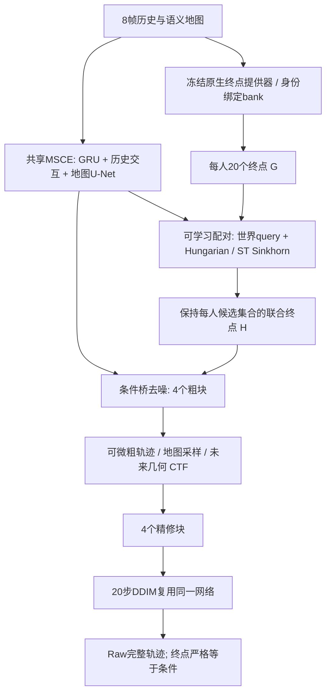

# 当前统一网络：方法与实现一致的定义

状态：原六层已有正式结果；八层门控主干是研究候选。
本定义只描述冻结终点＋可学习配对＋GT 一致条件桥，不混入历史 rollout/projection 方案。

## 1. 信息流

训练桥以 GT 终点条件配 GT 路径；图中的 H 条件用于推理。
训练时 G 进入配对损失，两个目标通过共享 MSCE 联合更新。

## 2. 有限候选的联合组合

对行人 i，原生候选为 G_i={g_i^1,…,g_i^K}，K=20。
学习每人的双射 π_i 后，第 k 个联合 world 为

\[
H^k=(g_1^{\pi_1(k)},\ldots,g_N^{\pi_N(k)}),\quad
q_\phi^K(H\mid X,M,G)=\frac1K\sum_{k=1}^K\delta_{H^k}.
\]

这是给定有限 bank 的等权经验耦合，不是可计算似然、已校准概率或全空间最优耦合。
对每个 i，π_i 是排列，因此

\[
\frac1K\sum_k\delta_{H_i^k}=\frac1K\sum_k\delta_{G_i^k},\qquad
\min_k\|H_i^k-y_{i,T}\|=\min_k\|G_i^k-y_{i,T}\|.
\]

这是边缘终点候选/minFDE 保持的代数性质，与网络是否训练好无关。
并不保证 minADE、联合误差、碰撞或概率校准。Hungarian 对给定分数求每人分配，
不能称为全场景真实交互代价的全局最优解。
训练使用 hard + soft − stopgrad(soft)，soft 为 20 次 log-Sinkhorn；
它是有偏代理梯度，没有声称离散目标的精确导数。

## 3. 端点条件桥

恒速基线 b 由最后两个观测速度均值构造。对固定终点 g：

\[
y_{1:11}=b_{1:11}+a(g-b_{12})+s_r Lz_r,\qquad y_{12}=g,
\]

其中 a_t=t/12，LLᵀ 为 Brownian bridge 协方差。L 可逆且 s_r>0，
所以给定 g 时，前 11 帧和 z_r 之间是可逆线性映射；终点约束直接由解码保证。
协方差用于白化，不是 Schrödinger bridge、不是新构造的随机扩散桥，
也不证明学习后的轨迹平滑或行人独立。
第12个潜变量槽仍用于辅助端点残差去噪，但 proposal_eta=0 时不改变解码端点。

## 4. 网络与精修

MSCE：历史6维运动特征→192维stem→单层GRU；2个历史社交块；
6通道语义图＋8通道GPU历史热图→本地U-Net→32通道全分辨率特征。
每人8个历史token＋64个地图token，共72个context token。

主干隐状态[B,K,N,12,192]。每块依次处理潜变量槽、同world行人、
每人上下文以及FFN(192→768→192)。新块条件为时间＋历史＋归一化终点相对基线，
为四分支分别产生scale/shift/tanh gate。Q/K沿head维做RMS归一化。
门控零初始化，初始block近似身份；不由此推出整体网络稳定性定理。

CTF按粗预测的物理轨迹计算运动特征、可微地图采样和未来行人对几何，
用alpha(t)²注入精修隐状态和social attention bias。原observed bias保留。
本快照保留legacy槽注入语义；白化桥槽并不等同物理时刻，原索引注入是一种建模选择。
decoder-energy汇聚历史试验已拒绝，没有合并到本目录。

## 5. 实际训练与推理

VP cosine：alpha=cos(pi t/2)，sigma=sin(pi t/2)；
x_t=alpha x_0+sigma epsilon；v_target=alpha epsilon−sigma x_0。
训练从100个非零时间bin采样，同场景共享时间。普通更新只有一次去噪调用。

\[
\mathcal L=\mathcal L_{v,final}+0.25\mathcal L_{v,coarse}
 +0.10\mathcal L_{map}+0.05\mathcal L_{geometry}+\mathcal L_{pair}.
\]

geometry含原alpha²门控；pair是按共同world聚合的归一化终点误差softmin。
主干和配对共享context图，但桥路径损失没有经过H反传到配对head；
“统一训练”表示同一模型/优化循环/共享编码器，不表示所有目标都端到端穿过所有模块。
GPU按绑定配置使用原混合精度，CPU检查为FP32。rollout/projection均关闭。

实际统一调度：最多30轮，前5轮warmup，随后25轮余弦衰减至初始LR的10%；
主干LR1e-4、map U-Net LR1e-5，AdamW。batch、累积、weight decay、
验证和early-stop沿用各fold绑定配置。选择best_eligible，否则best_jade，后者不代表合同通过。

推理每个scene使用20个world、20步确定性DDIM。G/H共享原始桥噪声，H按同一排列gather。
每步复用同一组8个block，不能称为160层独立网络。解码直接输出Raw轨迹。
SDD训练内部为近似米制，论文指标转换回像素；不得跨单位拼接平均。
